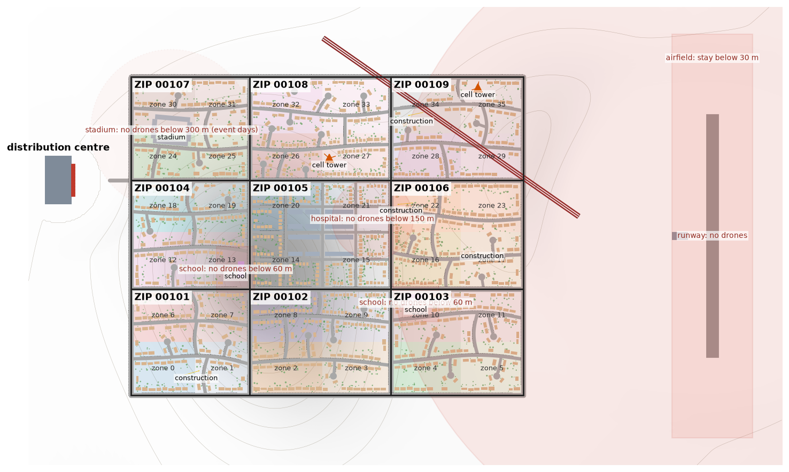
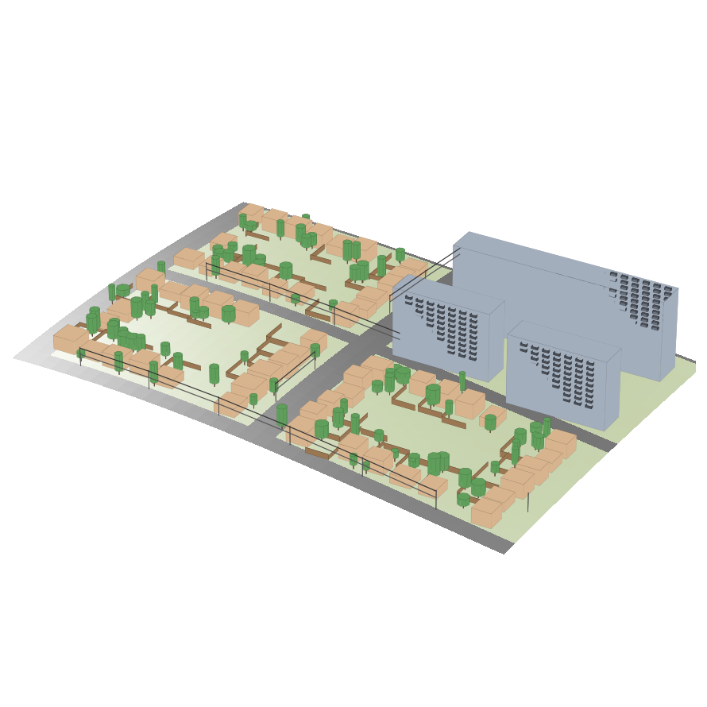
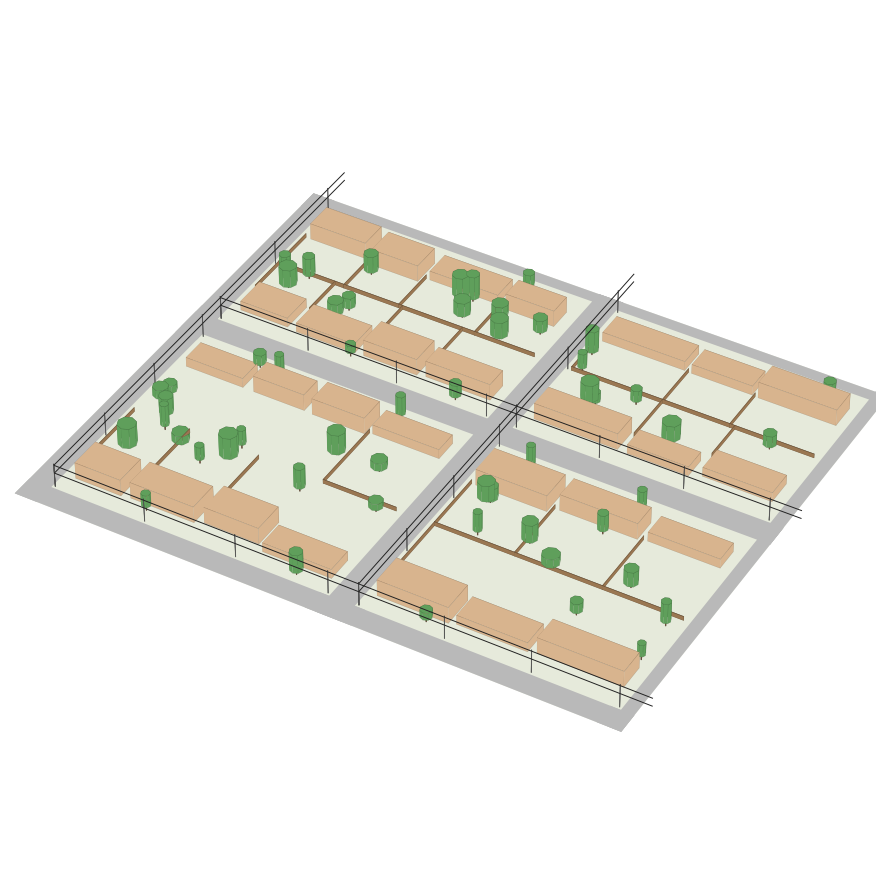
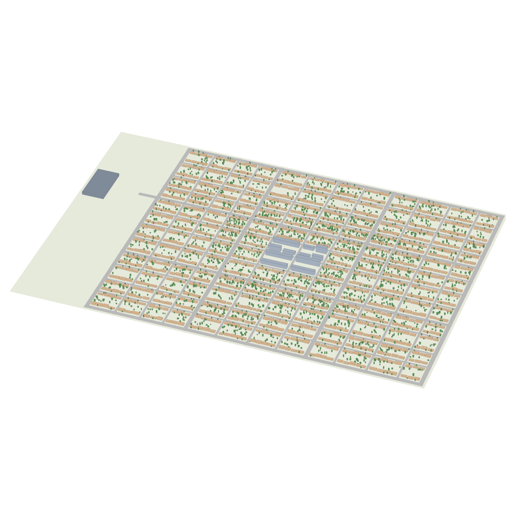

# Amazing Prime AI Drones

Can a fleet of autonomous trucks, each launching 10 delivery drones, deliver a city's parcels faster than Amazon does today?

Flying one drone to one point is solved. This project is about the operation around it: every day brings a random set of parcels across the city, and an optimiser has to decide which truck covers which zone, the route each truck drives, where it launches and recovers its drones, which drone takes which parcel, where and from what height each parcel is put down, and the 3D path each drone flies around power lines, trees and buildings. All of that changes with the weather and with each parcel's size, weight and fragility.

It's scored against a model of Amazon's current last mile: parcels arriving at a delivery station, Delivery Service Partner drivers in vans, and Prime Air drones flying from fixed sites. Both systems start from the same delivery station, with the same days, parcels and city. The Amazon model is built only from public figures and is deliberately generous: good routes for free and the fast end of every range. How it's built, and where each number comes from, is in [docs/amazon-baseline.md](docs/amazon-baseline.md).

This is an independent project and isn't affiliated with or endorsed by Amazon.

This started as a fork of [self-driving-optimized](https://github.com/siroxou/self-driving-optimized), a self-driving car sensor study. The road generator, vehicle model and traffic from that project now drive the trucks; everything car-specific was taken out.

**Status:** Phases 1 to 3 are done. The 3D city and random delivery days are in. So are both Amazon baselines (DSP vans, calibrated against Amazon's figures, and Prime Air drones from a fixed site), a trucks-only version of this project's system, and a classical solver for the full truck + drone fleet. The solver's drones now fly on a cost model with wind, payload, battery, flight heights and drop planning. Everything runs on the 50 held-out days in a few minutes. Next is Phase 4, a learned optimiser that has to beat the classical solver, and then the 3D drone sim, in the phases in [ROADMAP.md](ROADMAP.md).

## The city



Each seed gives a different city, about 1.5 x 1.2 km:

- **ZIP codes and zones:** straight arterial roads mark out 9 ZIP codes. Each ZIP splits into 4 delivery zones (its quarters), and every address belongs to one zone and one ZIP.
- **Streets:** the middle ZIP keeps a street grid. The ZIPs around it get two curving streets across each one, curving links between them and out to the arterials, and cul-de-sacs with turning circles off all of those. Houses face whatever street they're on.
- **Distribution centre:** a warehouse west of the city with 10 truck bays in its yard and an access road onto the middle arterial. Trucks start here.
- **Districts:** apartment blocks in the middle, with a balcony per flat on the street side. Small lots around them, bigger suburban lots further out.
- **Houses:** each lot has a house, a front and back yard, sometimes trees and fences. Every address has drop spots (porch, front yard, back yard, or its balcony) and the sim knows the clear height above each one, so a yard under a tree or a balcony under the one above is known in advance.
- **Hills:** broad hills and dips, about 60 m from the lowest point to the highest and up to 15% steep. Everything stands on the ground, and apartment floors are levelled from the high side so balconies clear the slope.

### Hazards and airspace

| Hazard | What's there |
|---|---|
| Power lines | poles down one side of every street outside the centre, with a power line at 9.5 m and a cable line at 6 m |
| High-voltage line | lattice pylons about 36 m tall across one corner of the city, 5 conductors from 25 to 36 m, with a 40 m strip under it kept clear of houses |
| Cell towers | two masts of 45–60 m, each held up by six guy wires anchored out to about half its height |
| Construction cranes | four building sites; on any given day most have a tower crane up, with its jib pointing a different way and its hook hanging at a different height. `City(seed, day=...)` changes only these and the stadium |
| Schools | no drones below 60 m over the school and its grounds, 7:30 to 16:00 |
| Hospital | no drones below 150 m within 150 m of the roof helipad, at any time |
| Stadium | no drones below 300 m within 300 m, 17:00 to 23:00 on event days |
| Airfield | east of the city: stay below 30 m within 1.2 km, and never over the runway or its approaches |

Airspace heights are above the ground under the drone. `city.airspace.blocked(points, hour)` says which zone, if any, each point is in.

| Edge of the centre | A suburban zone with a crane, pylons and power lines |
|---|---|
|  |  |



The default city (seed 0) has 2,038 addresses, 4,252 drop spots and about 12,000 obstacles, and builds in about 0.7 s. Other seeds give 1,700 to 2,000 addresses. Drones see the city through raycasts: about 1,900 casts of 64 rays a second on a laptop, against buildings, trees, wires and the hills.

```python
from sim.city import City

city = City(seed=0, day=0)
print(city.summary())
city.zip_codes[city.address_zip[0]], city.address_zone[0]   # ZIP code and zone of address 0
city.spot_pos[city.spot_address == 0]                      # its drop spots
city.terrain.height(x, y)                                  # ground height
city.obstacles.cast(origin, directions, 40.0)              # distances and what each ray hit
city.obstacles.touching(point, 0.5)                        # what a 0.5 m sphere at point is touching, or None
city.airspace.blocked(points, hour=10.5)                   # which no-fly zone each point is in, or ""
```

## A delivery day

Each morning a random set of parcels is waiting at the distribution centre. `Day(city, parcels=500)` gives:

- **Parcels:** each one has an address, a size (envelope to oversize), dimensions, a weight and a fragility (robust, careful, fragile). Addresses get about 1.45 parcels each, in line with what DSP routes report, and about 82–85% of parcels weigh 5 lb or less, close to the 86% Amazon gave when it announced Prime Air.
- **Recipients:** for parcels that go in the truck's locker, how far each person will walk to the truck and how soon they turn up.
- **Weather, hour by hour:** temperature, wind speed and direction with gusts, wind growing with height, and rain on about 30% of days.
- **Traffic:** `day.travel_time(hour)` gives the time to drive every road edge, with rush hours, busier and quieter streets, and rain.

```
$ python -m sim.day
city seed 0, day 0: 500 parcels to 328 addresses (1.52 per stop)
sizes: 30% envelope, 34% small, 24% medium, 10% large, 2% oversize
weight: median 0.9 kg, 82% at 5 lb (2.27 kg) or less, heaviest 20.5 kg
fragility: 70% robust, 21% careful, 9% fragile
recipients walk up to a median 251 m and turn up after a median 9 min
weather: 5 to 18 C, wind 5.1 m/s average with gusts to 11.1 m/s, 0.0 mm of rain
traffic: arterials take 1.64x as long at 8:00 as at 3:00
city built in 730 ms, city + day in 734 ms
```

Most of these settings are reasoned guesses, because there's little public data on parcel mixes or recipients. [docs/days.md](docs/days.md) lists every setting, where each one comes from, and which are guesses. The 50 benchmark days are saved in `data/held-out/` (city seeds 1000–1009, which training never uses), so benchmark results stay comparable.

## Results so far

The same 50 held-out days for every system, averaged ([results/baselines.md](results/baselines.md)):

| system | delivered today | last parcel | half of all parcels by | by 14:00 | vehicles | driver hours |
|---|---|---|---|---|---|---|
| Amazon DSP vans | 100% | 15:47 | 13:16 | 65% | 2 vans | 12.6 |
| Amazon Prime Air (10 drones) plus vans | 100% | 16:26 | 12:42 | 73% | 1.1 vans | 7.2 |
| Locker trucks, no drones (10 min wait) | 82% | 12:17 | 11:23 | 82% | 3 trucks | 0 |
| **Trucks with 10 drones each, classical solver** | 86% | 12:04 | 11:09 | 86% | 2 trucks | 0 |
| **The same, launching from the moving truck** | 87% | 11:58 | 11:02 | 87% | 2 trucks | 0 |

`python -m baselines.run` reruns this table in a few minutes. Results move from run to run because OR-Tools gets a fixed time per solve: across four runs, the vans' "half of all parcels by" ranged from 12:54 to 13:16.

**Does the fleet beat Amazon?** For the parcels it delivers, yes, and by a lot. It gets 86% of parcels out by 14:00 against about 65–70% for the vans, and finishes by about noon instead of mid-afternoon. But it leaves 14% of parcels behind, while the vans deliver every one. Those are locker parcels whose recipients didn't come out in time, and many are parcels the drones couldn't take because of wind. So it doesn't beat the vans outright, and how you weigh speed against parcels left behind decides the comparison. Much of what it depends on is still guessed. [results/baselines.md](results/baselines.md) lists what to trust and what not to, and the sections below explain each system.

## The Amazon baselines

### DSP vans

Vans load at the distribution centre from 9:30, leave at 10:00, deliver in the order OR-Tools plans, and must be back by 19:30. A stop is a building, so a whole apartment block counts as one. Routes are planned on drive times averaged over the shift, then driven with the traffic at the time of each leg.

**Calibration first.** The one setting that isn't public is how long a driver spends at each stop. It's fitted so a 10-hour route lands in Amazon's published 150–190 stops and 200–300 packages ([results/dsp-calibration.md](results/dsp-calibration.md)). It does, for both dense and suburban areas, with 166–209 s per stop, well inside what's physically plausible. The baseline uses the fast end, 166 s, which is the most generous choice for Amazon.

**On the 50 held-out days** (500 parcels each, [results/dsp-baseline.md](results/dsp-baseline.md)):

| | mean | range |
|---|---|---|
| vans | 2 | 2–2 |
| last parcel delivered | 15:46 | 15:11–16:27 |
| half the parcels delivered by | 12:57 | 11:37–14:18 |
| delivered by 14:00 | 69% | 47–87% |
| driver hours | 12.5 | 11.4–13.9 |

These numbers are what the drone fleet has to beat. Two things to keep in mind. Each van does 93–129 stops here, fewer than a full Amazon route, because 500 parcels fill a little more than one van; part-full routes finish early, which flatters the baseline. And routes through apartment blocks carry up to about 350 packages, above Amazon's 300, because a whole block is one stop. Amazon says dense routes carry more but gives no figure.

### Prime Air from a fixed site

Drones fly from a site at the distribution centre, one parcel at a time, at the MK30's published cruise speed and height. Each one lowers the parcel to 4 m over a clear yard and lets go. Vans take everything the drones can't. A drone can only take a parcel of 5 lb or less, in a box no bigger than medium, to a house with a yard that has open sky and 3 m clear around the drop. It can fly in light rain and gusts up to 12 m/s, and it goes round no-fly zones it can't fly over ([results/prime-air-baseline.md](results/prime-air-baseline.md)):

| drones at the site | by drone | vans | last parcel | half delivered by | by 14:00 | driver hours |
|---|---|---|---|---|---|---|
| none (vans only) | 0% | 2.0 | 15:46 | 12:57 | 69% | 12.5 |
| 5 | 29% | 1.1 | 16:54 | 13:04 | 67% | 7.4 |
| 10 | 30% | 1.1 | 16:26 | 12:41 | 73% | 7.2 |
| 20 | 30% | 1.1 | 16:24 | 12:30 | 74% | 7.2 |

What this shows so far:

- **What limits Prime Air is which parcels it can take, not how many drones it has.** Going from 5 to 20 drones barely changes anything. Of all parcels, 48% have no drop spot (flats, and yards with a tree, roof or shed in the way) and 17% are too heavy. Weather keeps another 3% on the ground (4 of the 50 days are grounded all day), and no-fly zones another 2%.
- **Drones save driver hours, not time.** With a third of the parcels in the air, one van can do the rest, so Amazon would run one van instead of two and save about 40% of the driver hours. But that one van finishes later, so the last parcel arrives later than with two vans.
- **The fixed site's 7.5-mile range doesn't bind here,** because the whole sim city is about a mile across. In a bigger city, range would start to matter.

The wind limit, the cargo box size and the reload time are guesses, because none are published; [docs/amazon-baseline.md](docs/amazon-baseline.md) lists them all.

## This project's trucks, without the drones

To see how much of any gain comes from the drones, the same autonomous trucks run with lockers only. Each truck stops at pickup points on the street, chosen so every recipient is within the distance they'll walk. People get 10 minutes' warning, walk over and open their compartment. The truck waits a set time at each point, and the parcels of anyone who misses it go back to the station ([results/trucks-only-baseline.md](results/trucks-only-baseline.md)):

| truck waits at each point | 10 min | 20 min | 30 min | DSP vans, for comparison |
|---|---|---|---|---|
| parcels delivered today | 82% | 93% | 97% | 100% |
| last parcel | 12:17 | 14:28 | 16:38 | 15:46 |
| half of all parcels by | 11:23 | 12:23 | 13:18 | 12:57 |
| delivered by 14:00 | 82% | 86% | 57% | 69% |
| vehicles | 3 trucks | 3 trucks | 3 trucks | 2 vans |
| driver hours | 0 | 0 | 0 | 12.5 |

Without drones, the locker trucks are faster than the vans, but only by leaving parcels behind or making people come out for them. The wait at each point trades one against the other. All of this rests on guessed recipient behaviour (how far people walk, how fast they come) that has no public data behind it; [docs/days.md](docs/days.md) says so. Recipients walk 90 m on average. The trucks need no drivers, but someone still has to watch over them remotely, and that isn't counted yet.

## This project's fleet: the classical solver

The first version of the fleet is planned with plain heuristics and OR-Tools. Each truck carries 10 drones and a locker. It parks at a series of stops. From each one its drones fly out to the parcels assigned to that stop and come back, and locker recipients nearby walk over. A drone takes any parcel up to 5 kg and large-box size, to a yard, a porch or a top-floor balcony with open sky. Everything else goes in the locker. Locker pickup points come first, drone parcels fly from the nearest one within 600 m, and the rest get launch stops of their own. At each stop the sorties are shared out between the drones, and the trucks are routed through the stops. When the weather or a no-fly zone stops a drone at the time the truck gets there, the parcel moves to the locker and the day is planned again ([results/classical-solver.md](results/classical-solver.md)).

Each flight is planned with the drone cost model ([docs/drone-model.md](docs/drone-model.md)). Power comes from rotor physics with the parcel's weight and drag. The battery holds less in the cold, and the drone holds 15 m/s through the air, so the wind changes its speed over the ground. Flight heights clear rooftops, trees and wires by 10 m and follow the airspace rules. At the address it drops, lowers or sets the parcel down, depending on fragility, gusts and room. Compared with the Phase 2 fixed-speed model, drones take 36% of parcels instead of 46%, mostly because of wind. The launch radius barely matters (300, 600 and 1,000 m give the same results within a few minutes), because locker pickup points are already close to most drone parcels. With `moving=True`, the trucks stop only for the locker. Drones take off from the truck wherever it is, and fly to meet it where it'll be after the drop, landing on it on the move. It works, but it changes only a few minutes either way: the trucks spend most of their day parked at locker pickup points, and the drones' 2–3 minute flights fit inside those stops ([results/moving-launch.md](results/moving-launch.md)). In this city the locker wait, not the drones, is what holds the trucks up.

## How it works

| Decision | Made by | Depends on |
|---|---|---|
| Zones per truck, and their order | optimiser | parcel locations, traffic, depot |
| Truck route, launch and recovery points | optimiser | road graph, traffic, drone range in today's wind |
| Drone or truck locker for each parcel | optimiser | size, weight, fragility, drop spot, weather |
| Locker pickup points and how long to wait | optimiser | where locker recipients live, legal places to stop |
| Which drone, and when it launches | optimiser | battery, distance, other sorties, the truck's route |
| Drop spot and release height | drop planner | yard, porch or balcony, obstacles, wind drift, fragility |
| 3D flight path | path planner | power lines, trees, buildings, wind |
| Flying and landing on the moving truck | flight stack (hand-written) | the drone's sensors |
| Driving the truck | autonomous driver | traffic, the route |

The optimiser starts as a classical solver (OR-Tools plus heuristics). A learned optimiser replaces it only where it beats it on held-out days.

Two sims share the same city:

- **Macro sim:** road graph travel times plus a drone time and energy model. Fast enough to run thousands of days, so this is where planners are trained and scored.
- **Micro sim:** full 3D drones with a quadrotor model and trucks driving in traffic. It replays planned days to check the plans hold and to calibrate the macro sim's drone model.

### A delivery

1. The truck drives to its zone. The optimiser has already picked which parcels go by drone and where each drone launches.
2. A drone lifts off the roof dock while the truck is moving and follows its planned path, above the power lines and around trees.
3. At the address it goes to the chosen drop spot, comes down to the planned height, and releases or lowers the parcel.
4. It flies to its recovery point and lands on the truck, which has kept driving.
5. If it's running low on battery or loses the truck, it lands somewhere safe instead and the plan adjusts.

Parcels too big or heavy for a drone ride in a locker on the truck. The truck parks at a pickup point near those addresses, the recipients are told it's there, and they walk over and collect them while the drones keep working.

## Sensors

In the micro sim, each drone carries everything a real delivery drone could reasonably use. All of them are on all the time; they're modelled with noise, bias, latency and dropout rather than switched off.

| Sensor | What the drone gets |
|---|---|
| GNSS (GPS) | position and velocity, with drift, and much worse next to tall buildings |
| IMU | acceleration and rotation rate, with bias |
| Magnetometer | heading, disturbed near the truck and power lines |
| Barometer | altitude, with drift |
| Airspeed | airspeed, which together with GNSS gives a wind estimate |
| Downward rangefinder | height above whatever is directly below |
| Optical flow | ground speed from the downward camera, for low flight and landing |
| 3D lidar / depth camera | distances in sectors all around, for buildings, trees, fences and wires |
| Truck beacon (UWB) | range and bearing to the truck's dock, plus the truck's speed and heading |
| Dock marker camera | exact relative position of the dock slot once it's in view |
| Fleet comms | positions and planned paths of nearby drones, with latency and dropout |
| Battery monitor | charge left, voltage, current draw |
| Payload sensor | whether the parcel is still attached and its weight |
| Motor telemetry | rotor speeds, to notice a failing motor |

## Quickstart

Tested on Python 3.11.

```bash
python -m venv .venv && source .venv/bin/activate
pip install -r requirements.txt -r requirements-train.txt
pytest tests
python -m sim.city       # build a city, print what's in it, time the raycasts
python -m sim.day        # build a delivery day: parcels, weather, traffic
python -m baselines.run              # every baseline on the 50 held-out days, in parallel (about 6 min)
python -m baselines.calibrate        # check the DSP van model against Amazon's figures (about 10 min)
python -m baselines.dsp --held-out   # DSP vans on the 50 held-out days (about 5 min)
python -m baselines.prime_air --held-out   # Prime Air at 5, 10 and 20 drones (about 15 min)
python -m baselines.trucks_only --held-out # trucks with lockers, no drones (about 15 min)
python -m baselines.classical --held-out   # the truck + drone fleet, classical solver (about 30 min)
python -m baselines.moving --held-out      # parked against moving launches (about 25 min)
python -m sim.render     # redraw the pictures in docs/images
```

## Layout

```
sim/city.py          city layout: streets, ZIP codes, zones, distribution centre, hills, houses, hazards, airspace
sim/geometry.py      3D obstacles and hilly ground: raycasts and contact checks
sim/airspace.py      no-fly zones with heights and hours
sim/day.py           a delivery day: parcels, recipients, weather, traffic; day files
sim/drone.py         drone cost model: power, battery, wind, flight heights, drop planning
sim/roads.py         driving times on the road graph
baselines/dsp.py     Amazon DSP vans: OR-Tools routes, shift with traffic
baselines/calibrate.py  checks the van model against Amazon's stops and packages per route
baselines/prime_air.py  Amazon Prime Air drones from a fixed site, vans for the rest
baselines/trucks_only.py  this project's trucks and lockers without the drones
baselines/classical.py  this project's truck + drone fleet, planned with heuristics and OR-Tools
baselines/moving.py  drones launching from and landing on the moving truck
baselines/run.py     runs every baseline on the held-out days in parallel
results/             calibration and benchmark results
sim/render.py        matplotlib pictures of the city
sim/world.py         single procedural roads and a 2D raycaster, from the car project
sim/vehicle.py       kinematic bicycle model and collision shape, used by the truck and traffic
sim/traffic.py       IDM traffic and parked cars around the truck
sim/policy.py        runs an exported policy with plain numpy
train/export.py      exports a trained PPO model to .npz for sim/policy.py
tests/               tests
docs/amazon-baseline.md  how Amazon's current last mile is modelled, with sources
docs/days.md         every setting for parcels, weather and traffic, and where it comes from
docs/drone-model.md  the drone cost model and drop planning, every setting
data/held-out/       the 50 fixed benchmark days
ROADMAP.md           phases and exit criteria
```

## License

MIT
