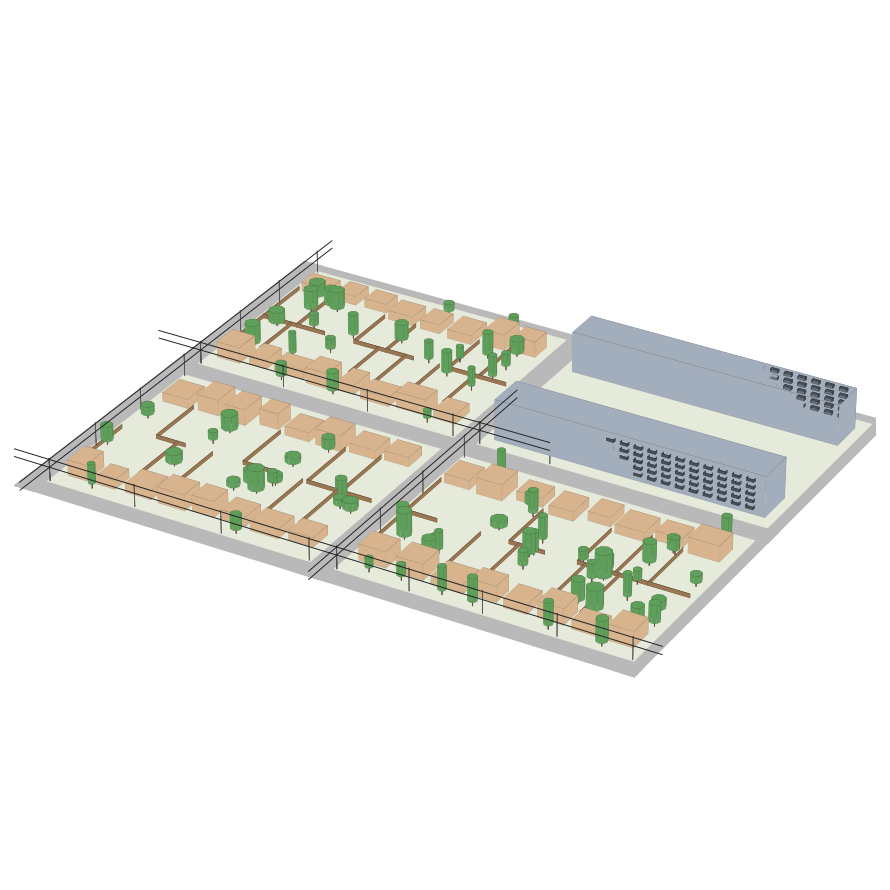

# Amazing Prime AI Drones

Can a fleet of autonomous trucks, each launching 10 delivery drones, deliver a city's parcels faster than Amazon does today?

Flying one drone to one point is solved. This project is about the operation around it: every day brings a random set of parcels across the city, and an optimiser has to decide which truck covers which zone, the route each truck drives, where it launches and recovers its drones, which drone takes which parcel, where and from what height each parcel is put down, and the 3D path each drone flies around power lines, trees and buildings. All of that changes with the weather and with each parcel's size, weight and fragility.

It's scored against a model of Amazon's current last mile: parcels arriving at a delivery station, Delivery Service Partner drivers in vans, and Prime Air drones flying from fixed sites. Both systems start from the same delivery station, with the same days, parcels and city. The Amazon model is built only from public figures and is deliberately generous: good routes for free and the fast end of every range. How it's built, and where each number comes from, is in [docs/amazon-baseline.md](docs/amazon-baseline.md).

This is an independent project and isn't affiliated with or endorsed by Amazon.

This started as a fork of [self-driving-optimized](https://github.com/siroxou/self-driving-optimized), a self-driving car sensor study. The road generator, vehicle model and traffic from that project now drive the trucks; everything car-specific was taken out.

**Status:** Phase 1 is in progress. The 3D city is in: streets, ZIP codes, delivery zones, the distribution centre, houses, apartment blocks, trees, fences and power lines. Parcels, weather, baselines, the optimiser and the drone sim come next, in the phases in [ROADMAP.md](ROADMAP.md).

## The city


Each seed gives a different city. The default is a 12 x 12 grid of blocks, about 1.5 x 1.2 km:

- **ZIP codes and zones:** arterial roads every 4 blocks bound 9 ZIP codes. Each ZIP splits into 4 delivery zones of 2 x 2 blocks, and every address belongs to one zone and one ZIP.
- **Distribution centre:** a warehouse west of the city with 10 truck bays in its yard and an access road onto the middle arterial. Trucks start here.
- **Districts:** apartment blocks in the middle, with a balcony per flat on the street side. Small lots around them, bigger suburban lots further out.
- **Houses:** each lot has a house, a front and back yard, sometimes trees and fences. Every address has drop spots (porch, front yard, back yard, or its balcony) and the sim knows the clear height above each one, so a yard under a tree or a balcony under the one above is known in advance.
- **Power lines:** poles down one side of every street outside the centre, carrying a power line at 9.5 m and a cable line at 6 m, including across junctions.

| Edge of the centre | Suburbs |
|---|---|
|  |  |


The default city has 2,058 addresses, 4,622 drop spots and about 14,000 obstacles, and builds in under 0.2 s. Drones see it through raycasts, about 3,300 casts of 64 rays a second on a laptop.

```python
from sim.city import City

city = City(seed=0)
print(city.summary())
city.zip_codes[city.address_zip[0]], city.address_zone[0]   # ZIP code and zone of address 0
city.spot_pos[city.spot_address == 0]                      # its drop spots
city.obstacles.cast(origin, directions, 40.0)              # distances and what each ray hit
city.obstacles.touching(point, 0.5)                        # what a 0.5 m sphere at point is touching, or None
```

## How it works

| Decision | Made by | Depends on |
|---|---|---|
| Zones per truck, and their order | optimiser | parcel locations, traffic, depot |
| Truck route, launch and recovery points | optimiser | road graph, traffic, drone range in today's wind |
| Drone or truck locker for each parcel | optimiser | size, weight, fragility, drop spot, weather |
| Locker pickup points and how long to wait | optimiser | where locker recipients live, legal places to stop |
| Which drone, and when it launches | optimiser | battery, distance, other sorties, the truck's route |
| Drop spot and release height | drop planner | yard, porch or balcony, obstacles, wind drift, fragility |
| 3D flight path | path planner | power lines, trees, buildings, wind |
| Flying and landing on the moving truck | flight stack (hand-written) | the drone's sensors |
| Driving the truck | autonomous driver | traffic, the route |

The optimiser starts as a classical solver (OR-Tools plus heuristics). A learned optimiser replaces it only where it beats it on held-out days.

Two sims share the same city:

- **Macro sim:** road graph travel times plus a drone time and energy model. Fast enough to run thousands of days, so this is where planners are trained and scored.
- **Micro sim:** full 3D drones with a quadrotor model and trucks driving in traffic. It replays planned days to check the plans hold and to calibrate the macro sim's drone model.

### A delivery

1. The truck drives to its zone. The optimiser has already picked which parcels go by drone and where each drone launches.
2. A drone lifts off the roof dock while the truck is moving and follows its planned path, above the power lines and around trees.
3. At the address it goes to the chosen drop spot, comes down to the planned height, and releases or lowers the parcel.
4. It flies to its recovery point and lands on the truck, which has kept driving.
5. If it's running low on battery or loses the truck, it lands somewhere safe instead and the plan adjusts.

Parcels too big or heavy for a drone ride in a locker on the truck. The truck parks at a pickup point near those addresses, the recipients are told it's there, and they walk over and collect them while the drones keep working.

## Sensors

In the micro sim, each drone carries everything a real delivery drone could reasonably use. All of them are on all the time; they're modelled with noise, bias, latency and dropout rather than switched off.

| Sensor | What the drone gets |
|---|---|
| GNSS (GPS) | position and velocity, with drift, and much worse next to tall buildings |
| IMU | acceleration and rotation rate, with bias |
| Magnetometer | heading, disturbed near the truck and power lines |
| Barometer | altitude, with drift |
| Airspeed | airspeed, which together with GNSS gives a wind estimate |
| Downward rangefinder | height above whatever is directly below |
| Optical flow | ground speed from the downward camera, for low flight and landing |
| 3D lidar / depth camera | distances in sectors all around, for buildings, trees, fences and wires |
| Truck beacon (UWB) | range and bearing to the truck's dock, plus the truck's speed and heading |
| Dock marker camera | exact relative position of the dock slot once it's in view |
| Fleet comms | positions and planned paths of nearby drones, with latency and dropout |
| Battery monitor | charge left, voltage, current draw |
| Payload sensor | whether the parcel is still attached and its weight |
| Motor telemetry | rotor speeds, to notice a failing motor |

## Quickstart

Tested on Python 3.11.

```bash
python -m venv .venv && source .venv/bin/activate
pip install -r requirements.txt -r requirements-train.txt
pytest tests
python -m sim.city       # build a city, print what's in it, time the raycasts
python -m sim.render     # redraw the pictures in docs/images
```

## Layout

```
sim/city.py          city layout: streets, ZIP codes, zones, distribution centre, houses, apartments, trees, power lines
sim/geometry.py      3D obstacles: raycasts and contact checks
sim/render.py        matplotlib pictures of the city
sim/world.py         single procedural roads and a 2D raycaster, from the car project
sim/vehicle.py       kinematic bicycle model and collision shape, used by the truck and traffic
sim/traffic.py       IDM traffic and parked cars around the truck
sim/policy.py        runs an exported policy with plain numpy
train/export.py      exports a trained PPO model to .npz for sim/policy.py
tests/               tests
docs/amazon-baseline.md  how Amazon's current last mile is modelled, with sources
ROADMAP.md           phases and exit criteria
```

## License

MIT
